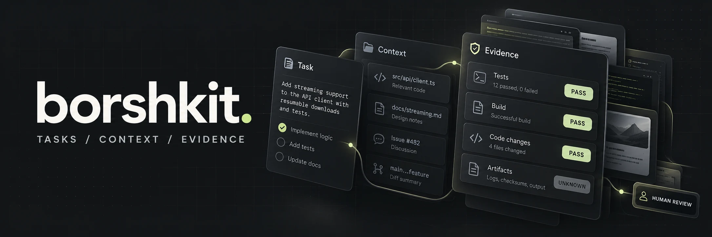

# Borshkit

[](https://parkpavel.github.io/borshkit/)

<sub>작업, 컨텍스트와 증거의 흐름을 보여 주는 일러스트입니다.</sub>

**AI 코딩을 위한 작업, 이식 가능한 컨텍스트와 검증 가능한 결과.**

결과를 정의하고 에이전트에게 작업을 맡기세요. 정확한 파일 상태에 연결된 증거와 사람이 확인할 체크리스트를 받습니다.

<a href="README.md">ru</a> · <a href="README.en.md">en</a> · <a href="README.de.md">de</a> · <a href="README.ko.md">ko</a> · <a href="README.zh-TW.md">zh-TW</a> · <a href="README.fr.md">fr</a>

[](https://github.com/ParkPavel/borshkit/releases) [](https://github.com/ParkPavel/borshkit/actions/workflows/ci.yml) [](LICENSE)

[](https://parkpavel.github.io/borshkit/read/guide/quickstart.html) [](https://parkpavel.github.io/borshkit/read/index.html) [](https://github.com/ParkPavel/borshkit/releases/tag/0.13.1) [](https://web.tribute.tg/d/Sh8)

## 시작하기

0.13.1 · Node.js 22+ · Git

**0.13.1:** 자세한 프로세스 진단, 제한된 대기 시간, 검사를 수행할 수 없을 때의 BLOCKED/UNKNOWN 상태. [변경 사항 및 알려진 제한](https://parkpavel.github.io/borshkit/read/release-0.13.1.html) (러시아어).

검증된 GitHub Release 압축 파일을 설치하세요. npm 레지스트리에는 아직 게시되지 않았습니다. 소스를 수정하려면 [git clone 및 npm link](https://parkpavel.github.io/borshkit/read/release.html)를 사용하세요.

```sh
npm install -g https://github.com/ParkPavel/borshkit/releases/download/0.13.1/borshkit.tgz
borshkit help
```

[Quickstart](https://parkpavel.github.io/borshkit/read/guide/quickstart.html) · [Guide](https://parkpavel.github.io/borshkit/read/guide/workflow.html) · [Commands](https://parkpavel.github.io/borshkit/read/reference/commands.html) · [Website](https://parkpavel.github.io/borshkit/)

## 현재 지원

CLI, Claude Code 플러그인과 VSIX를 제공합니다. Claude Code·Codex·Gemini·API 실행기와 VS Code의 Copilot·Roo·Cline 네이티브 API를 지원하며 한계를 명시합니다. 작업 전달과 JS/TS·Python·Go·Swift 정적 지도를 제공합니다. [지원 범위와 한계](https://parkpavel.github.io/borshkit/read/guide/native-integrations.html).

PASS: 검사 통과. FAIL: 검사 실패. UNKNOWN: 증거 없음. 실제 모델과 기기 시험은 사용자 피드백을 기다립니다. CLI 메시지와 대부분의 안내는 러시아어이며 명령에는 영어 별칭이 있습니다.

[Architecture](https://parkpavel.github.io/borshkit/read/architecture.html) · [Roadmap](https://parkpavel.github.io/borshkit/read/roadmap.html) · [상세 설명과 한계](https://parkpavel.github.io/borshkit/read/reference/overview.ko.html) · [Context handoff](https://parkpavel.github.io/borshkit/read/guide/handoff.html)


| 작업 | 컨텍스트 | 증거 |
|---|---|---|
| [목표, 범위와 기준](https://parkpavel.github.io/borshkit/read/reference/contract.html) | [환경 간 작업 전달](https://parkpavel.github.io/borshkit/read/guide/handoff.html) | [파일 상태에 연결된 검사](https://parkpavel.github.io/borshkit/read/concepts/evidence.html) |

<details>
<summary>유료 AI 모델이 필요한가요?</summary>

작업과 로컬 검사에는 모델이 필요하지 않습니다. 에이전트 작업은 별도로 설정한 환경과 요금제를 사용합니다.

</details>

<details>
<summary>무엇이 전달되나요?</summary>

계약, 결정 사항과 출처가 있는 제한된 컨텍스트입니다. 채팅 기록과 신뢰된 인수 결과는 전달되지 않습니다.

</details>

> ### Borshkit 후원
>
> 오픈 소스는 사람들의 참여로 발전합니다. 개발 시간과 더 쉬운 사용 경험을 지원해 주세요.
>
> [](https://web.tribute.tg/d/Sh8)


<details>
<summary>Credits / Источники</summary>


Borshkit은 보르시입니다. 다른 사람들이 기르고 누구나 쓸 수 있게 공개한 최고의 재료로 끓였습니다.

> 재료 중에는 두 번 익힌 것도 있습니다. Spec Kit은 먼저 Claudex에서 한 번 조렸고, 명세 검사로 다시 한 번 뭉근히 끓인 다음에야 Borshkit에서 완성됐습니다. 그래도 모두 멀쩡하게 식탁에 올랐습니다. 라이선스는 지켰고, 저자도 밝혔습니다.

| 재료 | 가져온 것 |
|---|---|
| [Claudex](https://github.com/ParkPavel/claudex) | 핵심: 작업 계약, 증거, 수렴, CLI 어댑터 |
| [Ponytail](https://github.com/DietrichGebert/ponytail) ([후원](https://github.com/sponsors/DietrichGebert)) | “게으른 시니어”: 최소한만, 단순하게 |
| [emilkowalski/skills](https://github.com/emilkowalski/skills) | 디자인 엔지니어링·모션 스킬 14개 |
| [ECC](https://github.com/affaan-m/ECC) ([후원](https://github.com/sponsors/affaan-m)) | 프런트엔드 스킬 9개, 모듈이라는 아이디어 |
| [Spec Kit](https://github.com/github/spec-kit) | “의도 → 명세 → 작업 → 수렴” 흐름 (Claudex를 거쳐, 두 번) |
| [Superpowers](https://github.com/obra/superpowers) ([후원](https://github.com/sponsors/obra)) | 에이전트용 별도 복사본, 수정 전에 테스트 먼저 (Claudex를 거쳐) |
| [Graphify](https://github.com/Graphify-Labs/graphify) ([후원](https://github.com/sponsors/safishamsi)) | 코드 맵에서 링크의 출처 추적 (아이디어, Claudex를 거쳐) |
| [prompt-agent](https://github.com/kvyb/prompt-agent) | 지난 작업 평가 (아이디어, Claudex를 거쳐) |
| [HIGAgentSkills](https://github.com/justinwetch/HIGAgentSkills) | Apple HIG 기준 라우팅 (링크만) |
| [Agent Reach](https://github.com/panniantong/agent-reach) | 리서처용 웹 수집 경로 |
| [free-llm-api-resources](https://github.com/raullenchai/free-llm-api-resources) | 무료 API를 고를 때 참고 (링크만) |

버전과 라이선스까지 담은 전체 레시피는 [docs/ingredients.md](https://parkpavel.github.io/borshkit/read/ingredients.html)(러시아어)에 있습니다. 이 프로젝트들의 **모든 기여자** 목록(1262개 항목)은 [CONTRIBUTORS-REFERENCES.md](CONTRIBUTORS-REFERENCES.md)에 있습니다. 한 분 한 분 모두 감사합니다!


API 참조 (코드 복사 없음): [VS Code Language Model API](https://github.com/microsoft/vscode) · [Roo Code API](https://github.com/RooCodeInc/Roo-Code) · [Cline API](https://github.com/cline/cline)

[Marked](https://github.com/markedjs/marked) · MIT · Markdown → HTML documentation.

</details>

Apache-2.0 · [LICENSE](LICENSE) · [NOTICE](NOTICE) · [Security](SECURITY.md)

Pavel Park · [GitHub](https://github.com/ParkPavel) · [Telegram](https://t.me/parkpavel_chigon) · [Support / Поддержать](https://web.tribute.tg/d/Sh8)
