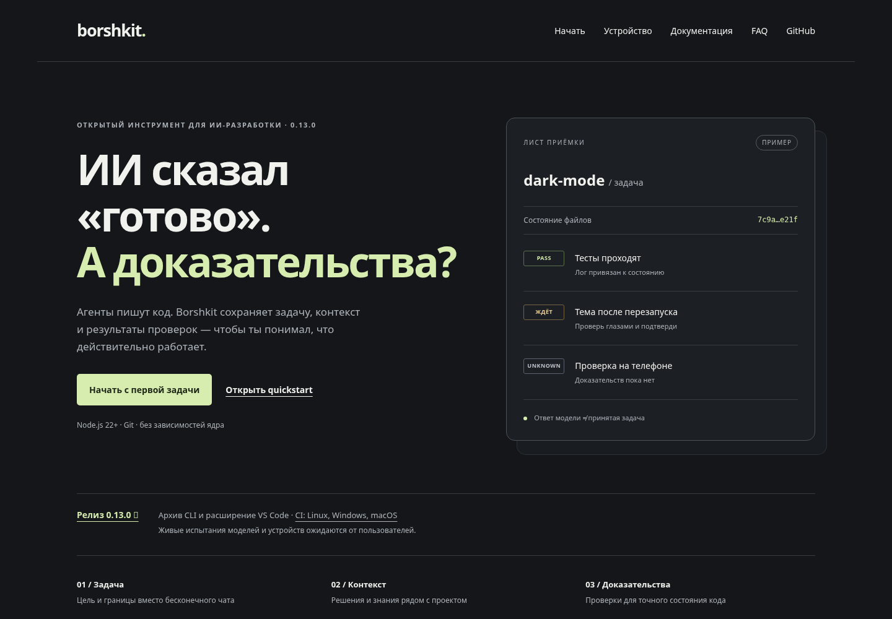
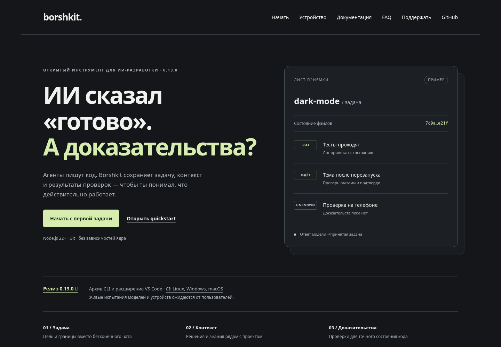
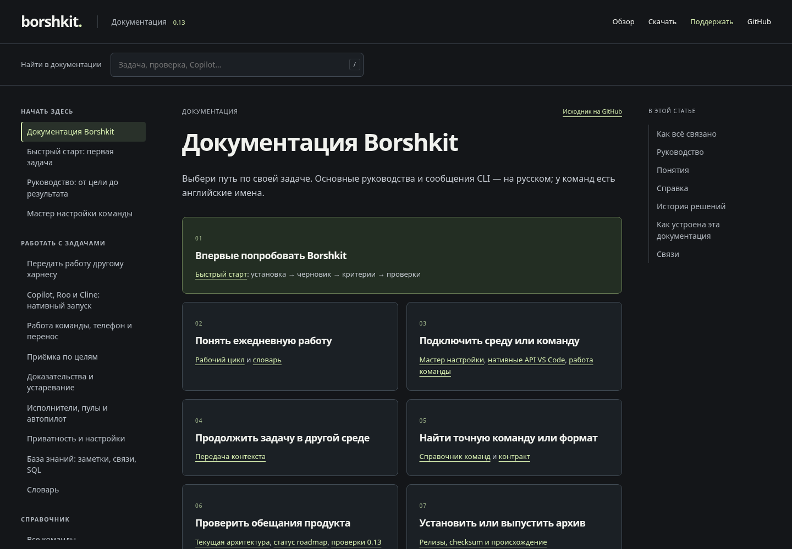
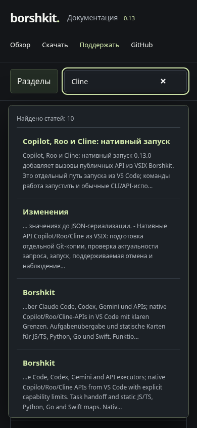
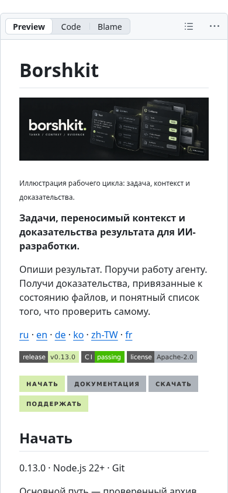
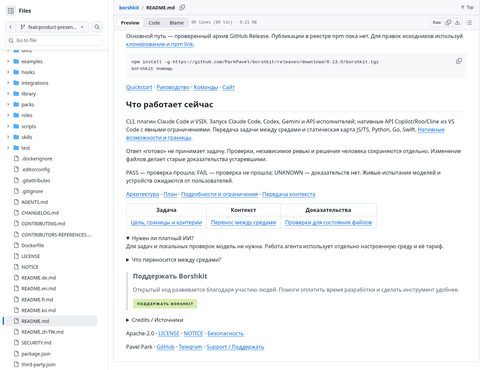

# Проверка продуктового оформления

final result: passed

## Визуальная опора и область сравнения

Источник — существующий сайт Borshkit в выбранном владельцем графитовом стиле с зелёным акцентом. Исходный первый экран и реализация открыты и просмотрены вместе: одинаковые 1440×1000 CSS px, deviceScaleFactor 1, reduced motion, состояние страницы без прокрутки. Снимки — 1440×1000 пикселей, нормализация плотности не нужна. Новый раздел документации расширяет эту систему; для него не заявляется соответствие несуществующему исходному макету 1:1.

- source visual truth path: [source-home.png](assets/product/qa/source-home.png)
- implementation screenshot path: [implementation-home.png](assets/product/qa/implementation-home.png)
- viewport: 1440×1000 CSS px; дополнительные 1024×768, 768×1024, 390×844, 320×800
- state: первый экран; далее документация, поиск, мобильное меню и README на GitHub

## Пять поверхностей проверки

| Поверхность | Результат |
|---|---|
| Типографика | Сохранены system sans, крупные заголовки и моноширинный код. В документации статья читается как основной слой; служебные подписи меньше и приглушены. Переносы проверены до 320 px. |
| Отступы и композиция | Desktop: разделы → статья → оглавление; на планшете оглавление убирается, на телефоне разделы открываются кнопкой. Карточки маршрутов и соседние статьи имеют устойчивую сетку. |
| Цвета | Сохранены #141619, светлый текст и #d6edaf. Блок поддержки использует тот же акцент. Полное соответствие WCAG не заявляется. |
| Изображения | Новый баннер сгенерирован Image Gen, сохранён в WebP без изменения композиции, около 96 КБ. Это иллюстрация процесса, а не скриншот GUI. В README на GitHub загружены все девять изображений/кнопок; готовые схемы проекта сохранены. |
| Содержание | Установка и поддержка ведут к действительным адресам; документация остаётся на сайте. Исходник на GitHub обозначен отдельно. Возможности моделей, npm и live testing не приукрашены. |

## История исправлений P0/P1/P2

1. P1: глобальный display:flex для nav раскладывал группы бокового меню и оглавление в горизонтальные колонки. Исправлено отдельным display:block в reader.css; новая desktop-съёмка показывает одну читаемую колонку разделов.
2. P2: якоря с одним # при HTML base вели к корню сайта. Сборщик формирует полный локальный маршрут статьи с якорем; переход и перезагрузка проверены в браузере, добавлена регрессия.
3. P2: без JavaScript мобильное меню было скрыто. Добавлен видимый HTML fallback; статья и переход между разделами реально проверены с отключённым JavaScript.
4. P2: ссылка README на read/README.html не соответствовала маршруту index.html. Исправлены языковые README и нормализация ссылки; проверены все локальные цели сгенерированных HTML.
5. P2: поиск пропускал команды в fenced code. Индекс сохраняет текст команд; добавлена проверка поиска npm install в quickstart.
6. До публикации ограничено копирование медиа картинками: страницы и скрипты passkey-интерфейса не становятся частью публичной документации. Регрессия проверяет отсутствие approval/index.html в media.

После исправлений новая съёмка и прогон не выявили оставшихся P0/P1/P2 в проверенных сценариях.

## Полноэкранная и детальная проверка

Основная композиция портала проверена в 1440×1000. Отдельные фокусные состояния — поиск в 390×844 и поддержка в реальном GitHub README, где видны размер текста, кнопки и раскрываемые элементы. Это новые экранные области, а не сравнение разных маршрутов как будто они должны совпадать.

## Проверки и ограничения

- Chromium: 1440×1000, 1024×768, 768×1024, 390×844, 320×800; навигация с главной в статьи, прямая ссылка и reload, поиск, мобильные разделы, копирование, якоря, таблицы, поддержка. Горизонтального переполнения страницы и pageerror нет.
- Проверены отказ загрузки поискового индекса и рабочая HTML-навигация без JavaScript.
- GitHub README открыт в ветке реализации на 1440×1100 и 390×844; загружены девять изображений, раскрытие ответов и ссылка поддержки проверены. После публикации нужны контроль URL Pages и повтор основных действий.
- npm run verify включает проверку актуальности HTML/Markdown и все тесты. Точный CI последнего SHA находится в PR, а не подменяется этой заметкой.
- Cloud browser сообщил SOCKS-сбой прямого открытия публичных хостов; его исследование использовало полученный HTTP-контент. Локальный Chromium среды напрямую открыл реальные GitHub-страницы и локальный HTTP-сайт; результаты скриншотов и действий относятся к этим прогонам.
- Не проводились пользовательское исследование, screen reader testing, Safari/Firefox и живые испытания аккаунтов моделей. GitHub README не исполняет JavaScript: интерактивный поиск и статьи находятся на сайте, а README использует ссылки, изображения и нативные details.

## Связи

- [Как собирается сайт](docs/guide/website.md)
- [Текущая архитектура](docs/architecture.md)
- [Первая задача](docs/guide/quickstart.md)
