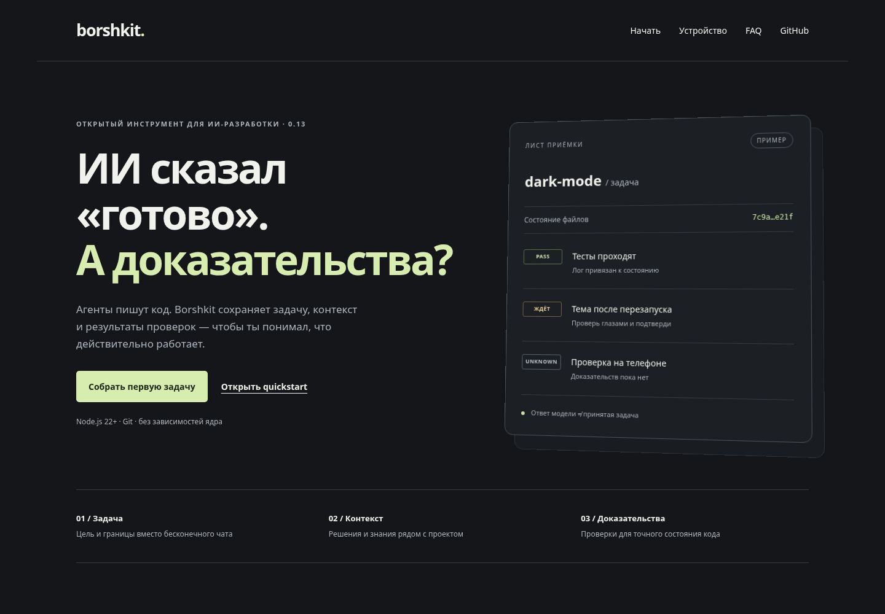
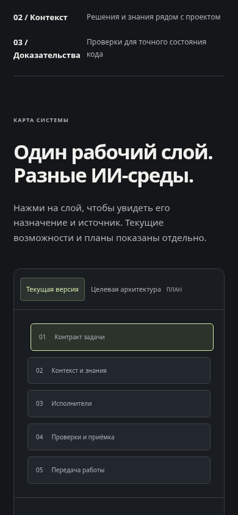
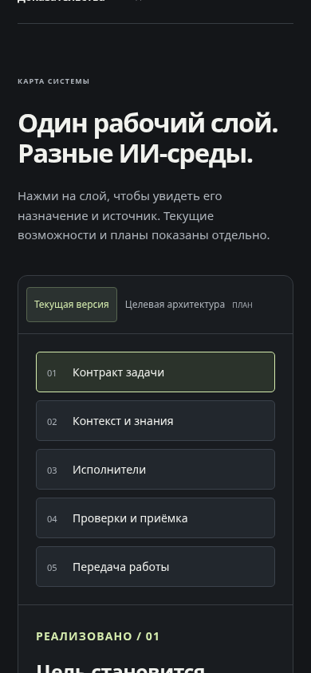
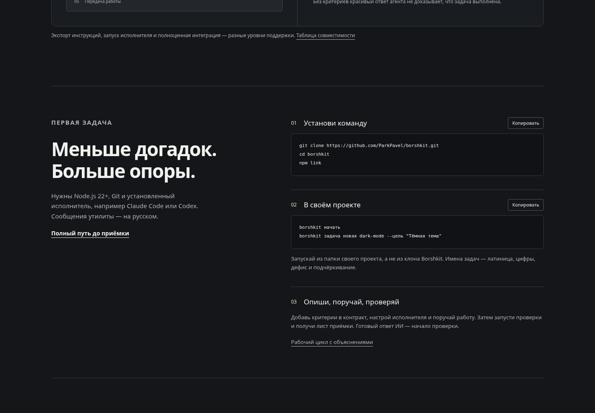
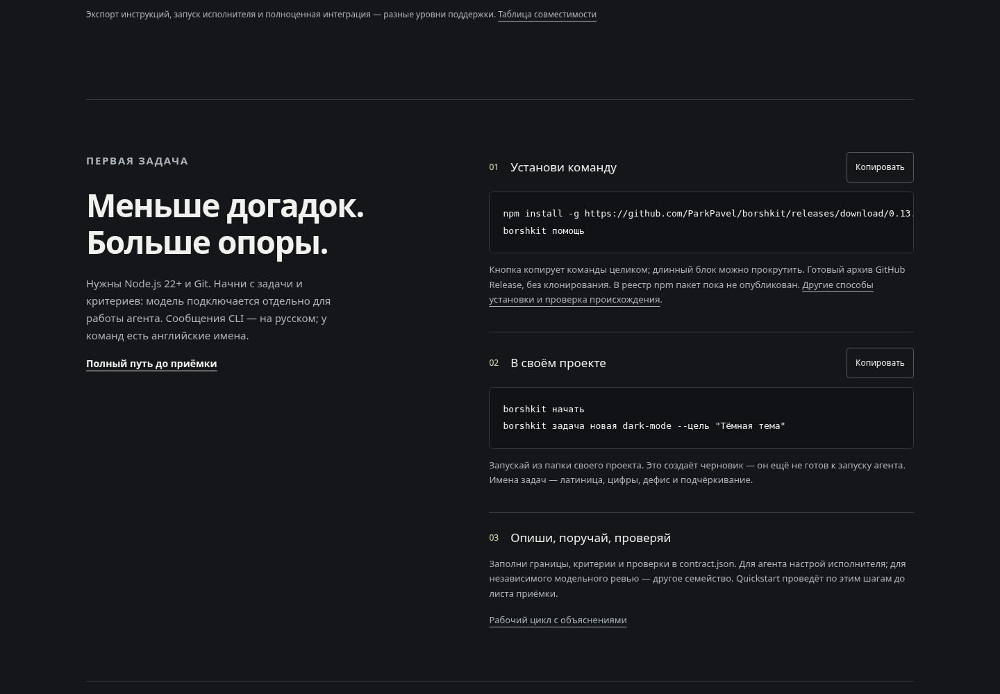
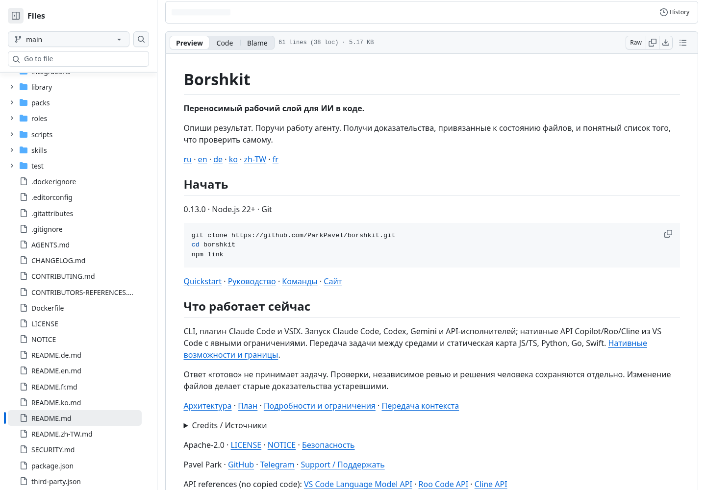
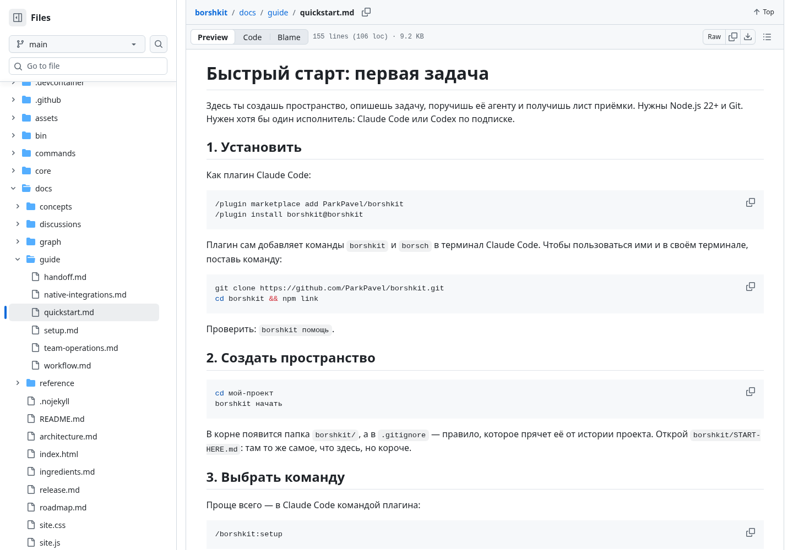

# Аудит оформления и достоверности — 22 октября 2026

## Вывод

Визуальная основа проекта цельная: графитовая палитра, один акцент, понятный пример листа приёмки, раздельные режимы реализации и планов. Главный долг был в согласованности: текущие README обещали нативный запуск, а справочники отрицали его; готовый релиз уступал место установке исходников; создание черновика выглядело почти завершённой настройкой.

Аудит выполнен по Product Design: свежие скриншоты → наблюдения → сверка с исходниками и публичным релизом → исправления → повторная проверка браузером. Это экспертная оценка, а не исследование поведения пользователей. Влияние на конверсию и понятность для новичков остаётся гипотезой.

Исходная версия: [`cab68d4`](https://github.com/ParkPavel/borshkit/commit/cab68d4f4d77eaab8ecb7d48276873aead728d4e), релиз 0.13.0. Проверены публичный [сайт](https://parkpavel.github.io/borshkit/), [README](https://github.com/ParkPavel/borshkit/blob/0.13.0/README.md), [quickstart](https://github.com/ParkPavel/borshkit/blob/0.13.0/docs/guide/quickstart.md), текущие руководства и языковые справочники. Старые обсуждения сохраняются как история своего времени.

## Путь пользователя и состояние шагов

| Шаг | Что делает пользователь | До исправлений | После |
|---|---|---|---|
| 1 | Понимает назначение по первому экрану | Хорошо: конкретная проблема и демонстрационный лист; версия сокращена, релиз и CI не видны | Сохранена подача; версия 0.13.0 и отдельные ссылки на выпуск/CI |
| 2 | Открывает карту текущей версии и планов | Есть разделение; весь текст кнопок уменьшен CSS до размера номера, особенно заметно на телефоне | Подписи 14 px, номера отдельно; связь контролов с панелями, видимый фокус; точная ссылка на handoff |
| 3 | Устанавливает CLI | Основной путь — clone/npm link, хотя опубликован готовый архив | Архив конкретного релиза, проверка команды help, ссылка на происхождение; установка исходников остаётся альтернативой |
| 4 | Создаёт первую задачу | Неочевидно, что это черновик без критериев; плагину приписана установка CLI в PATH | Черновик назван явно; CLI и плагин разделены; уточнены Git, taskId/base и два исполнителя в примере |
| 5 | Делегирует и получает проверки | Краткая посадочная страница скрывает важные решения; справочники противоречат нативным API | Явный переход в полное руководство, согласованные шесть языков, отдельные границы нативных API и живых испытаний |
| 6 | Принимает результат и переносит работу | Полный путь есть в quickstart; ручное подтверждение описано как технически недоступное агенту | Объяснено как действие человека, а не гарантия изоляции ОС; приёмка не переносится с handoff |

## Наблюдения и исправления

| ID / приоритет | Факт и свидетельство | Изменение |
|---|---|---|
| F1 / высокий | Шаги 3–5: на сайте три коротких шага против семи в quickstart; между созданием задачи и работой не виден обязательный контракт | Обозначены черновик, границы, критерии, проверки, исполнители и переход к полному пути |
| F2 / высокий | README описывает API 0.13; overview на шести языках и операционное руководство всё ещё отрицают нативный запуск | Согласованы текущие возможности и ограничения; полезная справка и сведения об авторах сохранены |
| F3 / высокий | Quickstart приписывает плагину глобальные команды, но hooks вызывают CLI по пути и не меняют PATH | Установка CLI показана отдельно от slash-команд и hooks |
| F4 / средний | Шаг 2: `.layer span:first-child` захватывает внешнюю обёртку подписи и делает её 10 px | Отдельный класс номера и читаемые подписи |
| F5 / средний | Две кнопки имеют одинаковое доступное имя «Копировать»; мобильные цели 69×27 px | Уникальные имена, область нажатия от 44 px, видимое сообщение и live region; отказ clipboard оставляет ручное копирование |
| F6 / средний | У переключателей нет явной связи с заменяемой панелью | Добавлены aria-controls и именованная область. Используется группа toggle buttons; роли tabs и стрелочная навигация для неё не обязательны |
| F7 / средний | Сайт и README начинают с разработки исходников, а готовый проверенный архив уже опубликован | Первичная установка из 0.13.0, ссылка на выпуск и точный CI; отсутствие пакета в registry объяснено |
| F8 / средний | Слой «Передача работы» ведёт в portable.mjs, хотя описывает task capsule | Ссылка исправлена на core/handoff.mjs; перенос задачи отделён от переноса файлов проекта |
| F9 / средний | Каталог документации сразу ведёт к команде, ресурсам и passkey; roadmap назван только будущими планами | Вход по потребности: первый запуск, цикл, среда, передача, справка, проверка обещаний; исторический и текущий статус различаются |
| F10 / низкий | В четырёх языковых README остался английский абзац; ссылки API вынесены после контактов; в справочниках упомянут отсутствующий счётчик | Абзацы локализованы, API-ссылки помещены в credits, ссылка на несуществующую метрику убрана |
| F11 / средний | GitHub API возвращает пустой homepage репозитория | Блокер: GitHub отклонил изменение About с HTTP 403 Resource not accessible by integration. Владелец может задать homepage в настройках репозитория; файлы сайта этим не заблокированы. |
| F12 / низкий | SessionStart всё ещё говорит, что удалённого подтверждения нет, хотя сопряжённый passkey реализован | Исправлена только подсказка; условия доверенного сопряжения и терминальный merge/push сохранены |

## Сверка продуктовых фактов

Здесь «есть в коде» не означает «проверено на реальном аккаунте». Ни один результат модели или устройства не додумывается.

| Утверждение | Основание | Вывод / точная граница |
|---|---|---|
| Node.js 22+, ESM, без runtime dependencies | package.json, scripts/check.mjs, workflow CI | Подтверждено конфигурацией и автоматическими проверками; наличие Git нужно для worktree |
| CLI и бином borsch | package.json bin, запуск установленного архива | Есть; плагины и CLI устанавливаются отдельно |
| Стабильный GitHub Release 0.13.0 | GitHub API: draft=false, prerelease=false, assets tgz/VSIX | Выпущен; это не обещание проверки всех моделей |
| Пакета в публичном npm пока нет | npm view borshkit version: E404, 22 октября | Архив GitHub устанавливается через npm без публикации в registry |
| Claude Code plugin | .claude-plugin, commands, skills, hooks | Файлы плагина есть; глобальная CLI в PATH им не устанавливается |
| Codex / Claude / Gemini / API | core/adapters.mjs, core/executors.mjs, тесты протоколов | Реализация запуска есть; реальные аккаунты и модельное качество этим не подтверждены |
| Copilot | core/native.mjs, integrations/vscode/native.cjs | LM API возвращает текст; нет инструментов или автоматической записи файлов |
| Roo | native.cjs | ID/события/отмена своей задачи; чужая работа не подменяется |
| Cline | native.cjs и руководство со ссылкой на закреплённый API | Только start; достоверные статус/отмена не заявлены |
| Строгая приватность нативного пути | core/native.mjs | Подготовка и запуск блокируются, пока политика данных не подтверждена; API расширений не даёт такого доказательства |
| Экспорт инструкций | core/integrations.mjs | Отдельный уровень поддержки; не добавляет API, sandbox или auto-approval |
| Изолированная копия | core/jobs.mjs ensureWorktree | Git worktree; не системный sandbox и не гарантия недоступности других файлов |
| Создание задачи | core/contract.mjs newTask / validateContract | Сначала пустые goals/criteria/checks; до заполнения это черновик |
| Доказательства и независимость | core/accept.mjs | Привязаны к состоянию и настройкам; UNKNOWN не PASS, неизвестное авторство не доказывает независимость |
| Передача | core/handoff.mjs, core/context-pack.mjs | Контракт/решения/ограниченный контекст с происхождением; импорт требует новых проверок и не клонирует чат |
| JS/TS, Python, Go, Swift, Markdown | core/code-map.mjs, core/kb.mjs | Лексическая карта и заметки; не компилятор, динамические/неразрешённые связи обозначаются |
| Таймауты и повторы Git | core/io.mjs, core/process.mjs, тесты | Ограниченные повторы чтения при временных сбоях; неоднозначные записи автоматически не повторяются |
| Passkey и телефон | core/approvals.mjs, core/approval-server.mjs, тесты fixtures | Реализация протокола после доверенного сопряжения; физический телефон и pentest не проверялись |
| 21 роль | 21 JSON + 21 Markdown в roles | Число соответствует файлам; пригодность конкретной модели требует отдельной оценки |
| Автопилот | defaultSettings в core/space.mjs | По умолчанию выключен; есть в исходниках, но не включается документацией автоматически |

## Проверки оформления и доступности

Chromium: 1440×1000, 768×1024, 390×844, 320×800. Проверены отсутствие горизонтального переполнения страницы, оба режима и все слои карты, правильный источник handoff, FAQ, skip link, клавиатурный фокус, именованные copy-кнопки, сообщения копирования и цели нажатия. При отключённом JavaScript есть ссылки на архитектуру и план вместо пустой интерактивной карты. Длинные команды прокручиваются внутри доступного с клавиатуры блока; копируются целиком. Режим reduced motion отключает движение.

Повторно скачан опубликованный tgz: SHA-256 `96964315b52433f485d90ee7ef5d3cc3de6bdf1f7539a8cb30692274ec3a76e9`. Установлен во временный prefix без install scripts; выполнены help, init и создание dark-mode в отдельном Git-проекте. Подтверждено создание черновика. Модели не запускались.

Проверены 479 локальных Markdown-ссылок во всех README и docs: цели существуют. `npm run verify`: 181 тест, 180 успешных, один платформенный пропуск локально; CI Linux/Windows/macOS и ссылка на конкретный SHA находятся в PR этого аудита. Это описание процедуры не заменяет реальный статус workflow.

Цвета основного текста и акцента дают хороший визуальный контраст на графитовом фоне; полного утверждения о WCAG нет. Не проводились screen reader testing, Safari/Firefox, испытания с пользователями, оценка конверсии, полный pentest, живые модели и физические устройства. Скриншоты не доказывают эти свойства.

## Скриншоты по шагам

Все снимки сделаны заново в этом аудите. Снимки с загрузкой или неверным участком GitHub были отклонены и пересняты. Исходные изображения сохранены без подмены макетами.

### Шаг 1 — первый экран до правок

### Шаг 2 — мобильная карта до и после

### Шаги 3–4 — установка до и после

### Шаги 5–6 — README и полный quickstart до правок

## Что проверять дальше

При получении пользовательских отчётов проверить первую установку на чистых Windows/macOS, сценарии реальных расширений, телефон и screen reader. Факт улучшения понятности требует наблюдения за новичками; экспертное ревью этого не доказывает. Публикация npm требует отдельной авторизации и не подменяется GitHub-релизом.

## Связи

- [Вход в документацию](../README.md)
- [Быстрый старт](../guide/quickstart.md)
- [Текущая архитектура](../architecture.md)
- [Реальные границы нативных API](../guide/native-integrations.md)
- [Проверка релиза](../verification-0.13.md)
